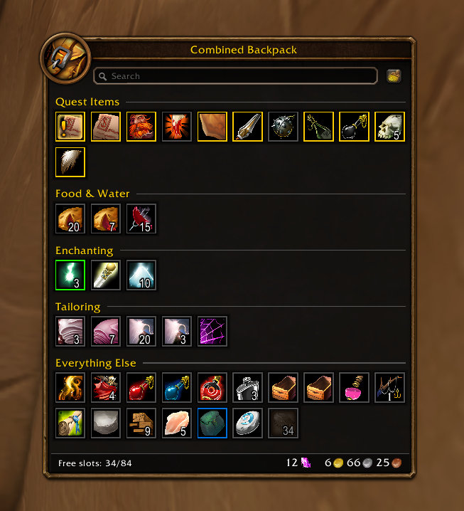

# Haversack

**All your bags in one small window, sorted into a few categories**, made for WoW: Forever.

- One window for all your bags, the soul bag included.
- Only a few categories: **Quest Items**, **Food & Water**, one for **each main
  profession you have learned** (Alchemy, Blacksmithing, Enchanting, Engineering,
  Herbalism, Leatherworking, Mining, Skinning, Tailoring) and **Everything Else**.
  Items are matched by item ID and item type, so it works in any client language.
- Square slots with a thin frame in the item's rarity color (yellow for quest items)
  and a soft shadow.
- Item level on weapons and armor, in the rarity color.
- Gold at the bottom, and for warlocks your Soul Shard count. Shards stay out of the
  grid so they don't fill the window.
- All empty slots shown as one slot with the free count on it.
- A search box and a button for the game's own bag sort.
- A clean, dark window that fits the game's own UI.
- English and German.

## Install

Copy this repository's files into a folder named `Haversack` inside
`World of Warcraft\_forever_\Interface\AddOns\`.

## Use

- **B** or **Shift-B** opens and closes all your bags. Haversack sends the backpack key
  to the game's own "Open All Bags"; your key bindings are not changed.
- **Escape**, or leaving a vendor, the mailbox or the bank, closes them as usual.
- Clicking one bag on the bag bar opens only that bag; the footer then says so.
- `/haversack reset` (or `/hsack reset`) puts the window back in its default place.
  Drag the title to move it.

## How it works

Haversack doesn't make bag slots of its own. It uses the game's own slot buttons from
its (invisible) bag windows and only arranges and restyles them. That keeps using,
moving, splitting and selling items exactly as in the default bags, also in combat,
and it never calls the game's open or close functions itself, which would block items
and action buttons in combat. That's also why the window has no close button: close it
with B, Shift-B or Escape.

## Tested so far

Version 1.0 was tested on a **Warlock** (with a soul bag) on WoW: Forever: opening and
closing with B, Shift-B and the bag bar, clicking and moving items, using items and
dragging them to the action bars in combat, and the Enchanting and Tailoring
categories. The other professions' categories are untested.
If an item lands in the wrong category, open an issue with the item and your professions.

## Changes

See [CHANGELOG.md](CHANGELOG.md).

## License

MIT, see [LICENSE](LICENSE).
